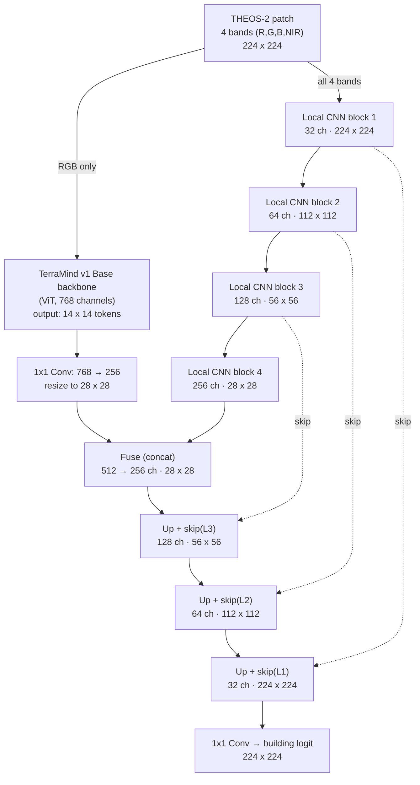

# Building Footprint Detection from THEOS-2 with TerraMind

Find buildings in **THEOS-2** satellite images (4 bands: Red, Green, Blue, Near-Infrared)
using the **TerraMind** geospatial foundation model, and export the results as polygons you can open in QGIS.

> This repo is a **step-by-step guide**. There is not much public information about TerraMind
> and geospatial foundation models yet, so I wrote down everything I learned to help you start your own project.

---

## What you get

| Notebook | What it does |
|---|---|
| [`01_finetune_building_footprint.ipynb`](notebooks/01_finetune_building_footprint.ipynb) | Teach (fine-tune) the model with your own images + building masks |
| [`02_predict_building_footprint.ipynb`](notebooks/02_predict_building_footprint.ipynb) | Use the trained model on new big images and export polygons |

**Output of prediction:**

1. Probability GeoTIFF: how likely each pixel is a building (0–1)
2. Raw mask GeoTIFF: building / not building
3. Clean mask GeoTIFF: after removing noise
4. Building polygons (GeoPackage `.gpkg`): open directly in QGIS
5. Summary CSV: one row per image

> **Not included:** the trained checkpoint and the THEOS-2 images / masks.
> They belong to the project owner and cannot be shared. You need to bring your own data.

---

## Model architecture

The model has **two branches**:

- **TerraMind branch:** looks at the RGB image and understands the *big picture* (city blocks, roads, context).
- **Local CNN branch:** looks at all 4 bands (RGB + NIR) at full resolution and keeps the *sharp edges* of buildings.

The two are joined together, then a U-Net style decoder builds the final mask.



**Why two branches?** TerraMind works on 16×16 pixel tokens, so on its own the building edges come out blurry.
The small CNN keeps the fine detail. Together they give both *context* and *sharp edges*.

---

## Full workflow

```mermaid
flowchart LR
    subgraph Fine-tune [01 · Fine-tune]
        A[Images + masks<br/>in Google Drive] --> B[Check size / CRS /<br/>transform match]
        B --> C[Find valid area<br/>skip NoData 0 / 65535]
        C --> D[Cut 224 x 224 patches<br/>balance pos : neg = 1 : 1]
        D --> E[Train / val split 80 / 20]
        E --> F[Train<br/>BCE + Dice + Focal]
        F --> G[(best checkpoint .pth)]
    end
    subgraph Predict [02 · Predict]
        G --> H[Sliding window<br/>over full scene]
        H --> I[Probability map]
        I --> J[Threshold 0.5]
        J --> K[Clean: remove small objects,<br/>fill holes, open / close]
        K --> L[Polygons + area filter<br/>12 – 10,000 m²]
        L --> M[GeoPackage → QGIS]
    end
```



---

## Quick start (Google Colab)

1. Open the notebook in **Google Colab**.
2. Go to **Runtime → Change runtime type → GPU** (T4 is OK).
3. Put your data in Google Drive (see [Data format](#-data-format)).
4. Edit **only** the settings cells (marked `แก้ไขส่วนนี้` = *"edit this part"*):
   - `IMAGE_SOURCES`: folder or file of your images
   - `MASK_SOURCES`: folder of your building masks *(fine-tune only)*
   - `CHECKPOINT_URL`: Google Drive share link to your checkpoint (`.pth`)
5. Run all cells from top to bottom.

>  The notebook text is written in **Thai**, but the code and variable names are in English.

---

## Data format

**Image:** GeoTIFF, at least 4 bands in this order: `1=Red, 2=Green, 3=Blue, 4=NIR`.
NoData can be `0` or `65535`.

**Mask** *(only for fine-tuning)*: a single-band GeoTIFF:

- `0` = background
- `> 0` = building
- must have the **same width, height, CRS and transform** as the image

```text
MyDrive/
├── THEOS2_images/
│   ├── THEOS2_SCENE_01.tif
│   └── THEOS2_SCENE_02.tif
└── building_masks/
    ├── scene_01_mask.tif
    └── scene_02_mask.tif
```

If the image and mask names are different, add them to `MANUAL_MASK_MAP` in the notebook:

```python
MANUAL_MASK_MAP = {
    "THEOS2_SCENE_01": "scene_01_mask.tif",
}
```

---

## Main settings

| Setting | Default | What it means |
|---|---|---|
| `PATCH_SIZE` | 224 | Size of each square the model sees |
| `EPOCHS` | 2 | Training rounds (2 is a quick demo; use more for real work) |
| `BATCH_SIZE` | 4 | Patches per step |
| `LEARNING_RATE` | 1e-4 | How fast the model learns (AdamW) |
| `FREEZE_BACKBONE` | True | `True` = train only the decoder (fast). `False` = train everything (slower, needs more GPU) |
| `MAX_PATCHES_TOTAL` | 2000 | Limit on patches, to keep the demo short |
| `NEGATIVE_TO_POSITIVE_RATIO` | 1.0 | Number of empty patches per building patch |
| `THRESHOLD` | 0.5 | Probability needed to call a pixel "building" |
| `MIN_BUILDING_AREA_M2` | 12 | Remove polygons smaller than this |
| `MAX_BUILDING_AREA_M2` | 10000 | Remove polygons bigger than this |

**Loss** = `0.50 × BCE + 0.35 × Dice + 0.15 × Focal`
BCE checks each pixel, Dice helps because buildings are a small part of the image, and Focal focuses on the hard pixels.

---

## Use this for your own project

- **Another object** (solar panels, swimming pools, …)? Keep the same notebook and just change the masks.
- **Another satellite** with RGB + NIR? It should work. Check the band order and the NoData values.
- **Only RGB?** Change the local CNN input from 4 to 3 channels (`ConvBlock(4, 32)` → `ConvBlock(3, 32)`) and train again.
- **No checkpoint yet?** Build the backbone with `pretrained=True` to start from the official TerraMind weights, and skip loading the checkpoint.

---

## Common problems

| Problem | Fix |
|---|---|
| `GPU is required` | Runtime → Change runtime type → GPU |
| `strict=True` load error | The checkpoint was made with a different architecture. Use the same model class. |
| The model predicts nothing | Check that the mask really lines up with the image (open both in QGIS). |
| The whole border becomes "background" | Check `NODATA_VALUES`. |
| Package conflict with NumPy | Restart the runtime after `pip install` |

---

## Learn more

- [Beginner's guide to GeoFM and TerraMind](docs/GEOFM_BEGINNER_GUIDE.md)
- TerraMind model: https://huggingface.co/ibm-esa-geospatial/TerraMind-1.0-base
- TerraTorch: https://github.com/torchgeo/terratorch

## Related repos

Part of my geospatial foundation model series:
- [Building footprint (THEOS-2)](https://github.com/mastersungx1/terramind-building-footprint-theos2)
- [Rice mapping (Sentinel-2 time series)](https://github.com/mastersungx1/terramind-rice-mapping-sentinel2)
- [Flood mapping (Sentinel-1 + 2)](https://github.com/mastersungx1/terramind-flood-mapping-sen1floods11)
- [Road extraction (THEOS-2)](https://github.com/mastersungx1/theos2-road-extraction-multitask)

## Acknowledgement

Developed during my internship at **I-bitz (Insight)**. Thank you to the team for the support and for allowing me to share this work.
The company's data, labels and trained checkpoints are **not** part of this repository.

## License

Code: [MIT](LICENSE). TerraMind and TerraTorch have their own licenses.
